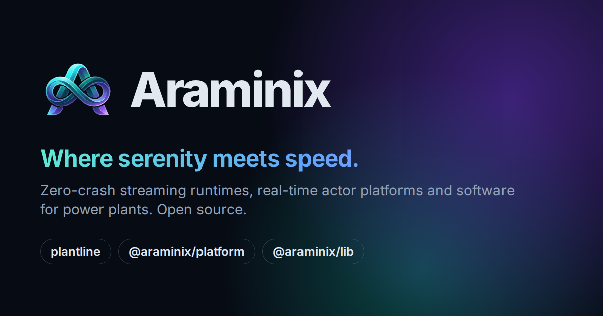

<p align="center">
  <a href="https://araminix.github.io/"></a>
</p>

> **The Araminix website: the open-source work of Amin Abbasi in one place, from software for power plants and
> the protocols they speak to real-time runtimes, libraries and starters.**

[](https://araminix.github.io/)
[](https://github.com/araminix/araminix.github.io/actions/workflows/pages/pages-build-deployment)
[](LICENSE)

**[Visit araminix.github.io](https://araminix.github.io/)**

## On the site

| Project | What it is | Links |
| --- | --- | --- |
| [plantline](https://araminix.github.io/#plantline) | Single-line diagrams and DWG/DXF plant layouts in the browser, for solar, wind, storage, hydro and grid projects | [Open the app](https://araminix.github.io/plantline/) · [Source](https://github.com/araminix/plantline) |
| [Gridlingo](https://araminix.github.io/#gridlingo) | Learn how energy devices talk: 48 grid protocols played step by step between real devices, every byte explained, in 14 languages | [Start learning](https://araminix.github.io/gridlingo/) · [Source](https://github.com/araminix/gridlingo) |
| [@araminix/platform](https://araminix.github.io/#platform) | An actor-based application runtime and WebSocket platform for Node.js | [npm](https://www.npmjs.com/package/@araminix/platform) · [Source](https://github.com/araminix/platform) |
| [@araminix/lib](https://araminix.github.io/#lib) | Universal, type-safe multiplexed WebSocket streaming | [npm](https://www.npmjs.com/package/@araminix/lib) · [Source](https://github.com/araminix/lib) |
| [gach](https://araminix.github.io/#gach) | Chainable colours and styles for terminal text | [npm](https://www.npmjs.com/package/gach) · [Source](https://github.com/amin-abbasi/gach) |
| [Micro-service boilerplates](https://araminix.github.io/#boilerplates) | A layered Express 5 service to start from | [TypeScript](https://github.com/amin-abbasi/typescript-boilerplate) · [JavaScript](https://github.com/amin-abbasi/javascript-boilerplate) |

Also on the page: three studies from real work ([ArangoDB edge patterns](https://github.com/amin-abbasi/arango-edge-patterns),
[Node.js performance gotchas](https://github.com/amin-abbasi/node-performance-gotchas) and
[a flash-sale system design](https://github.com/amin-abbasi/system-design-flash-sale)), a
[Go starter](https://github.com/amin-abbasi/go-boilerplate), writing, and the story behind Araminix.

## How the site is made

- **Static, with no framework and no dependencies.** Node.js builds `index.html` from plain data; GitHub Pages
  serves the files as they are.
- **Private.** No cookies, no analytics, and no third-party scripts or fonts. A Content Security Policy allows only
  the site's own files and the two count APIs.
- **Live numbers.** Star counts come from the GitHub API and download counts from the npm API, in the visitor's
  browser, and are kept for an hour; without them the page shows the numbers written in `scripts/content.mjs`.
- **Light and dark**, following the system or the visitor's choice, on phones, tablets and desktops.

## Editing

Change the text in `scripts/content.mjs`, then build:

```sh
node scripts/build.mjs
```

The build writes `index.html` and one cover picture per repository in `assets/img/covers/`. Commit both.

| File | Holds |
| --- | --- |
| `scripts/content.mjs` | Everything the page says: products, the featured library and starters, the other repositories, capabilities, the technology list, writing, the founder |
| `scripts/build.mjs` | The page's markup |
| `scripts/art.mjs` | The drawings: the hero, the package diagrams and the repository covers |
| `scripts/icons.mjs` | The icons used (Lucide, and the GitHub mark) |
| `assets/css/site.css` | All styles, light and dark |
| `assets/js/theme.js` | Applies the chosen theme before the page draws |
| `assets/js/site.js` | Theme switch, phone menu, and live star and download counts |

A repository shown like a product (gach, the boilerplates) goes in `featured`, with its own picture in `build.mjs`.
A smaller one goes in `repos`, with an `icon` from `scripts/icons.mjs` and a `tone` from `TONES` in
`scripts/art.mjs`; the build draws its cover. Only repositories worth advertising are listed: maintained, tested or
documented, and relevant to Araminix; every one is public on github.com/araminix or github.com/amin-abbasi, the
account the Araminix organisation belongs to. To add an icon, copy its inner SVG from https://lucide.dev into
`scripts/icons.mjs`. When a project is added or removed, change the table under [On the site](#on-the-site) too.

## Looking at it locally

```sh
python3 -m http.server 8080
```

Then open http://localhost:8080/.

## Licences

- Code (scripts, styles, markup): MIT, see [LICENSE](LICENSE).
- Texts, the Araminix logo, the photo and the product screenshots: © Araminix, not covered by the MIT licence.
- Inter: SIL Open Font License 1.1, see `assets/fonts/Inter-OFL.txt`.
- Lucide icons: ISC License, © Lucide Contributors. GitHub mark: Octicons, MIT License, © GitHub.
